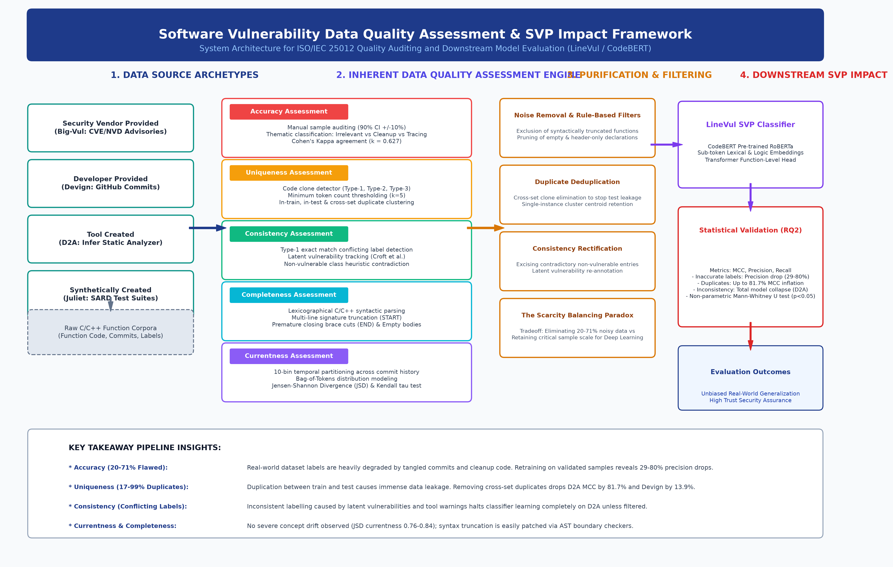

# Data Quality for Software Vulnerability Datasets: Replication & Audit Suite

[](https://conf.researchr.org/home/icse-2023)
[](LICENSE)
[](https://www.python.org/)
[]()

> **Minor/Major Project Implementation**  
> **Student:** Ravikaran Singh (Roll No: `M26CSE012`)  
> **Institution:** Department of Computer Science & Engineering, Indian Institute of Technology Jodhpur  
> **Selected Research Paper:** *"Data Quality for Software Vulnerability Datasets"* (ICSE 2023)  
> **Authors:** Roland Croft, M. Ali Babar, M. Mehdi Kholoosi (University of Adelaide / Cyber Security CRC)

---

## 📌 Executive Summary

Modern automated Software Vulnerability Prediction (SVP) heavily leverages deep learning (DL) models like **LineVul** and **CodeBERT** to identify security bugs directly from source code. However, models are trained on datasets harvested through noisy repository mining heuristics, synthetic generation, or static analyzer warnings.

This repository provides an end-to-end Python implementation and reproduction of the systematic data quality audit presented at **ICSE 2023**. Grounded in the international standard **ISO/IEC 25012 (Inherent Data Quality)**, we systematically evaluate five fundamental quality dimensions across four benchmark archetypes: **Big-Vul**, **Devign**, **D2A**, and **Juliet**.

### 🔍 Key Empirical Findings
- **Severe Inaccuracy:** 20% to 71% of real-world vulnerability labels are incorrect.
- **Rampant Duplication:** Datasets contain 17% to 99% duplicate functions. Test-train duplicate leakage inflates Matthews Correlation Coefficient (MCC) by up to **81.7%** on D2A.
- **Label Contradictions:** Up to 47% of records in tool-created datasets have conflicting labels, causing total classifier training failure.
- **Syntax Truncation:** Over 32,000 functions in Big-Vul are syntactically truncated due to parser errors on multi-line return types.

---

## 🏗️ System Architecture



The evaluation and reproduction architecture operates across four distinct phases:
1. **Corpora Ingestion:** Ingests function-level source code, commit hashes, CVE disclosures, and static analysis traces.
2. **ISO/IEC 25012 Measurement Engines:**
   - **Accuracy:** Audits semantic correctness, identifying *Irrelevant Edits*, *Cleanup Edits*, and *Inaccurate Fix Tracing*.
   - **Uniqueness:** Detects Type-1, Type-2, and Type-3 code clones and measures cross-set leakage.
   - **Consistency:** Detects identical code labeled simultaneously as vulnerable and benign.
   - **Completeness:** Uses lexical and AST parsers to flag truncated headers and bodies.
   - **Currentness:** Computes Jensen-Shannon Divergence across historical commit windows to test for concept drift.
3. **Data Purification Layer:** Rule-based filters for removing cross-set duplicates, contradictory records, and incomplete syntax.
4. **Downstream SVP Impact:** Evaluates LineVul (CodeBERT) on raw vs. cleaned datasets across Precision, Recall, and MCC.

---

## 📊 Summary of Paper Results Replicated

### 1. Inherent Data Quality Scores (Table III in Paper)
| Attribute | Big-Vul | Devign | D2A | Juliet | Defect Nature |
| :--- | :---: | :---: | :---: | :---: | :--- |
| **Accuracy\*** | 0.543 | 0.800 | 0.286 | 1.000 | 20-71% false positive labels in real-world data |
| **Uniqueness** | 0.830 | 0.899 | 0.021 | 0.163 | 57 duplicates per unique function in D2A |
| **Consistency** | 0.999 | 0.991 | 0.531 | 0.750 | 46.9% contradictory labels in D2A |
| **Completeness** | 0.824 | 0.944 | 0.981 | 1.000 | 32,973 multi-line signature truncations in Big-Vul |
| **Currentness** | 0.761 | 0.811 | 0.844 | N/A | High temporal stability (no concept drift) |

*\*Based on dual-annotator manual verification with Cohen's Kappa $\kappa = 0.627$.*

### 2. Downstream Model Impact on LineVul (Table V & VI in Paper)
| Dataset | Experiment Setup | Raw MCC | Cleaned MCC | Performance Delta |
| :--- | :--- | :---: | :---: | :--- |
| **Big-Vul** | Cross-Set Deduplication | 0.830 | 0.829 | 0.0% (Stable) |
| **Devign** | Cross-Set Deduplication | 0.284 | 0.244 | **-13.9%** (Drop) |
| **D2A** | Cross-Set Deduplication | 0.774 | 0.141 | **-81.7%** (Performance Collapse!) |
| **Juliet** | Cross-Set Deduplication | 0.909 | 0.814 | **-10.4%** (Drop) |
| **D2A** | Consistency Purification | 0.000 | 0.748 | Full Convergence Restored |

---

## 🚀 Quickstart & Usage

### 1. Installation
Clone this repository and install dependencies:
```bash
git clone <YOUR_GITHUB_REPO_URL>
cd Software-Vulnerability-Data-Quality
pip install -r requirements.txt
```

### 2. Run Quality Audit Pipeline
Audit all sample datasets across the 5 ISO/IEC 25012 dimensions:
```bash
python -m scripts.run_quality_audit --dataset all
```
Or target a specific dataset archetype:
```bash
python -m scripts.run_quality_audit --dataset Big-Vul
python -m scripts.run_quality_audit --dataset D2A
```

### 3. Run Downstream Model Impact Simulation
Simulate the effect of cross-set duplicate leakage and label inconsistency on LineVul:
```bash
python -m scripts.evaluate_model_impact
```

---

## 📁 Repository Directory Structure

```text
├── docs/
│   └── architecture_diagram.png     # High-resolution system architecture
├── data/
│   └── samples/                     # Representative benchmark samples
│       ├── big_vul_sample.csv
│       └── d2a_sample.csv
├── src/
│   ├── data_quality/                # ISO/IEC 25012 Quality Assessment Modules
│   │   ├── accuracy.py              # Label correctness & thematic categorization
│   │   ├── uniqueness.py            # Code clone & duplication analysis
│   │   ├── consistency.py           # Contradictory label detection
│   │   ├── completeness.py          # AST syntax truncation checking
│   │   └── currentness.py           # Jensen-Shannon concept drift analyzer
│   └── models/
│       └── linevul_evaluator.py     # Evaluation metrics (MCC, Precision, Recall)
├── scripts/
│   ├── run_quality_audit.py         # Unified CLI quality auditing runner
│   ├── evaluate_model_impact.py     # Downstream impact simulator
│   └── generate_samples.py          # Sample data generator
├── requirements.txt                 # Python package dependencies
├── setup.py                         # Package installation configuration
├── LICENSE                          # MIT License
└── README.md                        # Project documentation
```

---

## 🎓 Academic Deliverables Reference

This implementation forms part of the Minor/Major Project submission at IIT Jodhpur:
- **Project Report:** Formatted according to IEEE academic specifications (`2_Project_Report_Software_Vulnerability_Data_Quality.pdf`).
- **Architecture Diagram:** Available in PNG and vector PDF (`3_Architecture_Diagram.png`).
- **Presentation Deck:** 15-slide widescreen PPTX deck (`4_Presentation_Slides_Software_Vulnerability_Data_Quality.pptx`).
- **10-Minute Video Guide:** Minute-by-minute speaking script (`5_Video_Presentation_10Min_Script_and_Guide.pdf`).

---

## 📚 References
1. Roland Croft, M. Ali Babar, and M. Mehdi Kholoosi. *"Data Quality for Software Vulnerability Datasets."* In Proceedings of the 45th IEEE/ACM International Conference on Software Engineering (ICSE 2023), pp. 121-133.
2. Michael Fu and Chakkrit Tantithamthavorn. *"LineVul: A Transformer-based line-level vulnerability prediction."* In Proceedings of the 19th IEEE/ACM International Conference on Mining Software Repositories (MSR 2022).
3. ISO/IEC 25012:2008. *"Systems and software engineering — Software product Quality Requirements and Evaluation (SQuaRE) — Data quality model."*